# @stash/extension

The Zen / Firefox extension, built with [WXT](https://wxt.dev). See [CLAUDE.md](CLAUDE.md) for the
rules of this app.

## Install

The web app serves the extension at `/downloads/stash-extension.xpi`, and its **Connect** page
(Zen / Firefox) links to it. Open the link in Zen or Firefox and confirm the install.

Zen and release Firefox install only add-ons signed by Mozilla. `xpinstall.signatures.required`
is honoured only in Firefox Developer Edition, Nightly and ESR, so Zen ignores it. The deploy
therefore signs the `.xpi` as an **unlisted** add-on on addons.mozilla.org (AMO). Unlisted means
self-distributed: it has no public listing, and AMO signs it automatically. Signing needs the AMO API
key in env (`WEB_EXT_API_KEY`, `WEB_EXT_API_SECRET` from the `AMO` item in the `Stash` vault,
see `.env.example`). Without it the deploy serves an unsigned `.xpi`, which installs only in
Developer Edition or Nightly with `xpinstall.signatures.required` set to `false`. In Zen, load it
temporarily instead: `about:debugging` → "This Firefox" → "Load Temporary Add-on…". `package:xpi`
writes `stash-extension.json` (`{ "signed": true|false }`) beside the `.xpi`, and the Connect
page's Zen guide reads it to show the install steps that work for the file it serves.

## Build

```sh
pnpm --filter @stash/extension build   # → apps/extension/.output/stash-<version>-firefox.zip
pnpm --filter @stash/extension package:xpi -- <out.xpi>   # what the deploy runs
```

The deploy sets `STASH_WEB_ORIGIN` to the web app's own origin for this build, and
`wxt.config.ts` bakes it into the bundle (`build-origin.ts`). The `.xpi` a Stash serves therefore
knows where it came from, and its options page connects with one button. No address is committed:
a build without the variable (the two commands above, `dev`) has no built-in Stash and asks for
the address. To try the one-button path locally, set it yourself:

```sh
STASH_WEB_ORIGIN=http://localhost:8791 pnpm --filter @stash/extension build
```

WXT builds Firefox as Manifest V2 (its default for Firefox). The unpacked build is in
`.output/firefox-mv2/`. `package:xpi` (`scripts/package-xpi.ts`) zips it, or signs it with
`web-ext sign --channel unlisted` when the AMO key is set. AMO signs each version only once, so a
signed build gets a dated version (`1.<YYYYMMDD>.<minute>`). The signed file is cached in
`.output/signed/` under a hash of the build, so an unchanged extension is not signed again.

## Develop

```sh
pnpm --filter @stash/extension dev
```

This builds `.output/firefox-mv2-dev/` and starts WXT's dev server on `0.0.0.0:3000`, rebuilding
on every change. WXT opens Firefox with the extension when `web-ext` can start a browser. On WSL or a
remote host it can't: load the extension by hand in Firefox or Zen at `about:debugging` →
"This Firefox" → "Load Temporary Add-on…", and pick `.output/firefox-mv2-dev/manifest.json`.

## Setup

Installing the extension opens its options page (later: `about:addons` → Stash → Preferences).

| Not connected | Waiting for approval | Connected | Stash unreachable |
|---|---|---|---|
| 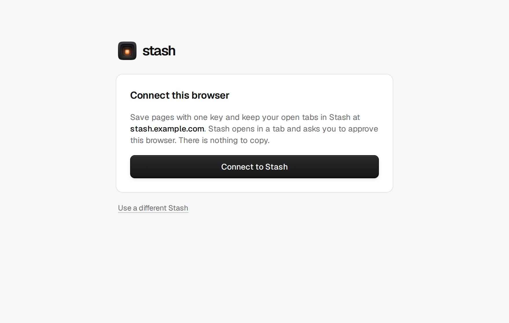 | 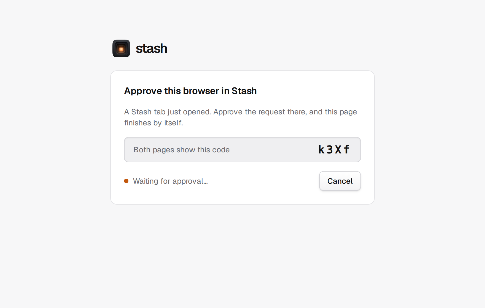 | 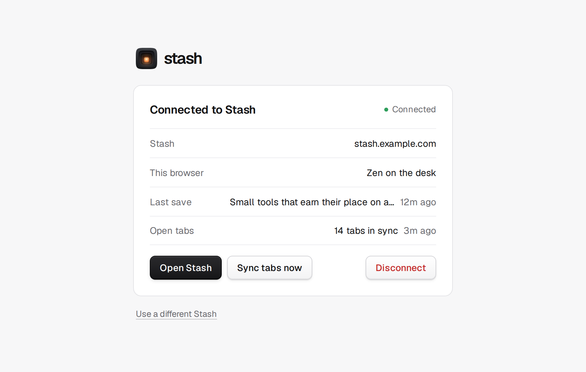 | 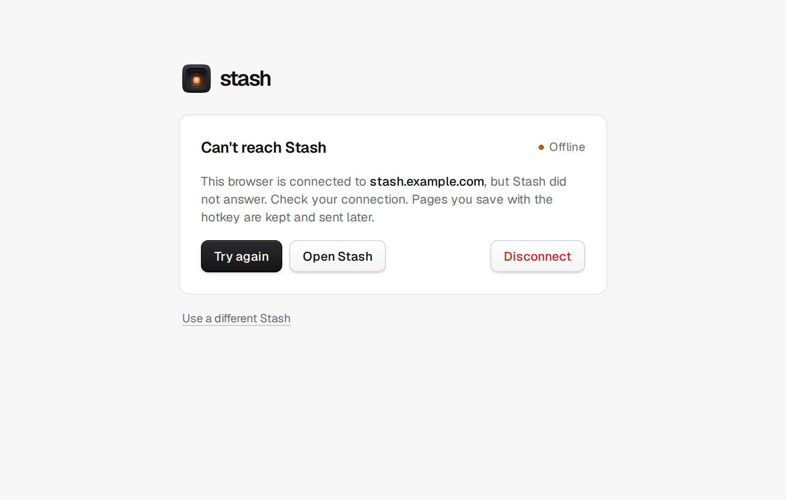 |
| 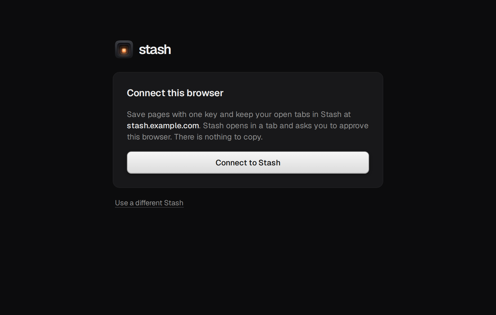 | 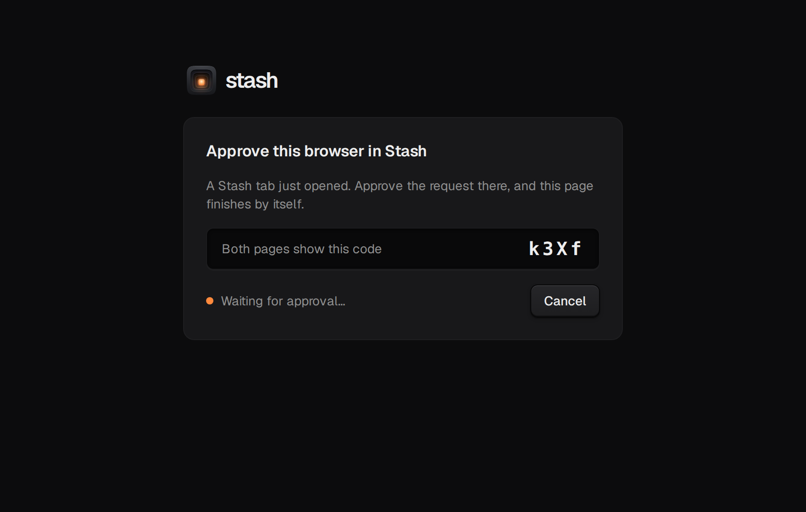 | 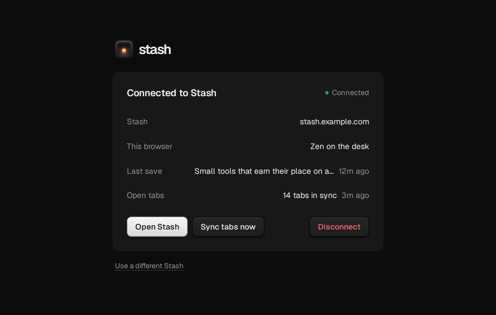 | 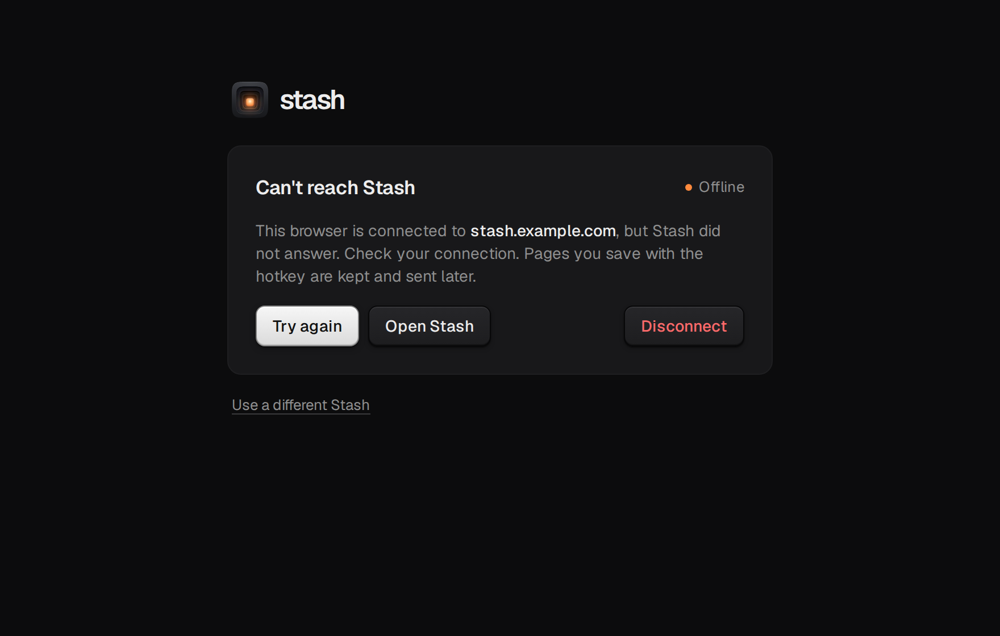 |

Click **Connect to Stash**. There is nothing to type: the extension knows the Stash it was
downloaded from. A Stash tab opens (sign in if asked) and asks to connect this browser.
Both pages show the same four-character check code: compare them before you approve, so a request
another page started can't pass for yours. Approve it, and the options page gets its own device
token and comes back to the front: there is nothing to copy. Under the
hood the page makes a one-time code, the web app registers a new Zen device and binds the code to
it in one transaction (`POST /pairings`), and the options page claims the token with the code (`POST /pairings/claim`,
polled every 2 seconds for up to 15 minutes).

Once connected, the page shows the Stash and the device this browser acts as, the last page it
saved (`GET /devices/activity`) and when its open tabs were last in sync, with **Open Stash**,
**Sync tabs now** (sends the open tabs even when nothing changed) and **Disconnect** (asks first,
then forgets the device token; the device stays listed in Stash until you remove it there). The
page follows the browser's light or dark theme.
`pnpm --filter @stash/extension screenshots:options` retakes the pictures from made-up data
(`preview/options/`).

**Use a different Stash** under the card takes another address to connect to, and under it
**Enter a device token by hand** takes an API URL (`https://<stash>/api`) and a device token.
It checks them with `GET /auth/me` and keeps the previous settings if the API rejects
them.

Once a device token is saved, the background page polls `GET /devices/:id/commands?status=pending`
every minute (and on start), runs each command (`close-tab` closes every tab with that URL) and
acks it `done` or `failed`. The device id comes from `GET /auth/me`.

The popup's **Connect this browser** button opens the same page.

## Use

Click the Stash toolbar button, or press <kbd>Alt</kbd>+<kbd>Shift</kbd>+<kbd>A</kbd>, to open the
popup:

| Not connected | Connected | Saved |
|---|---|---|
| 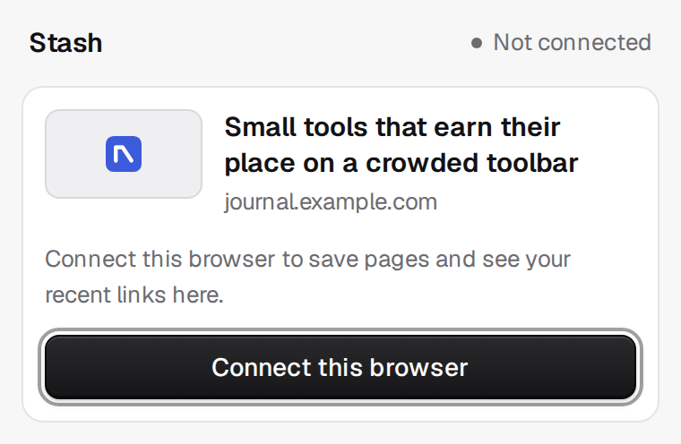 | 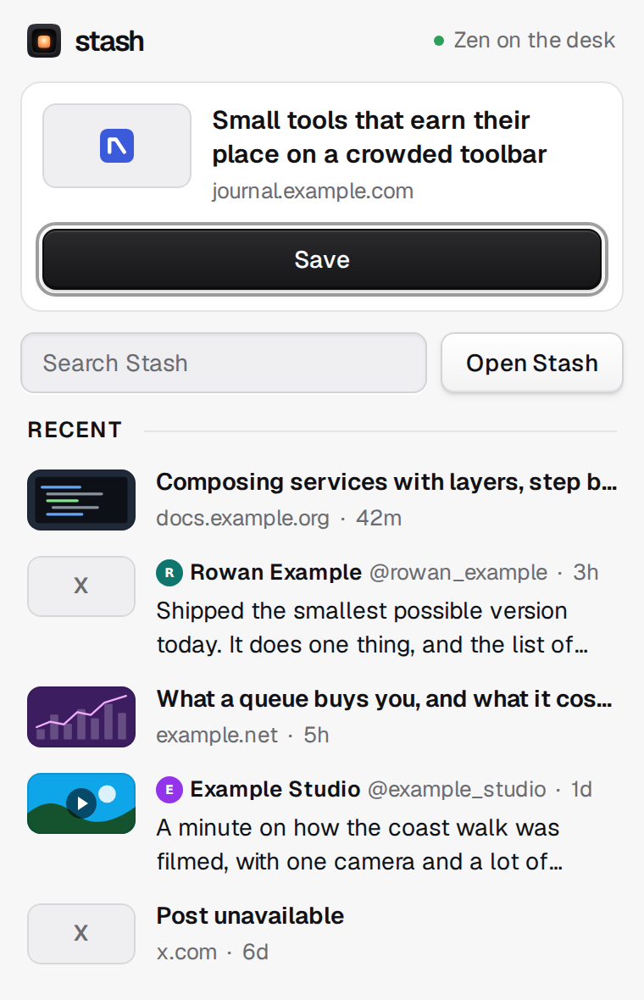 | 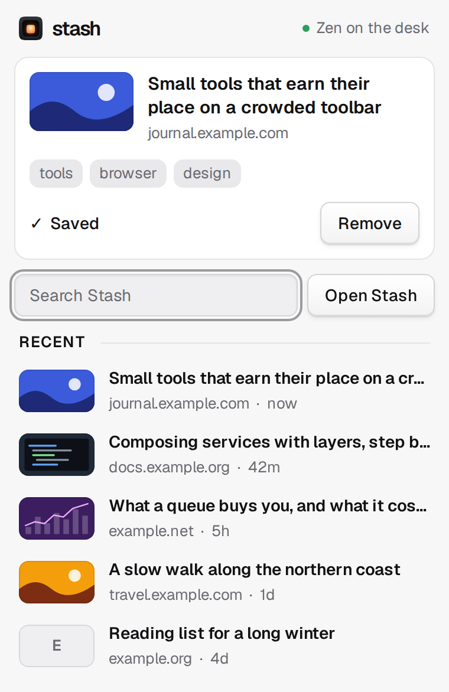 |
| 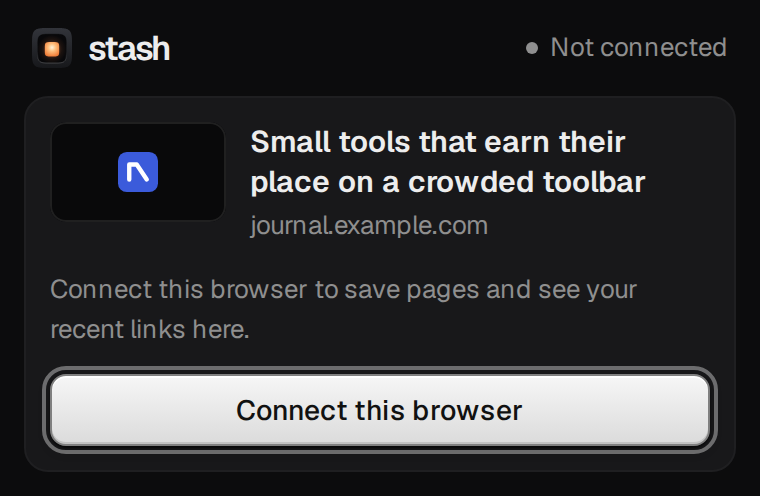 | 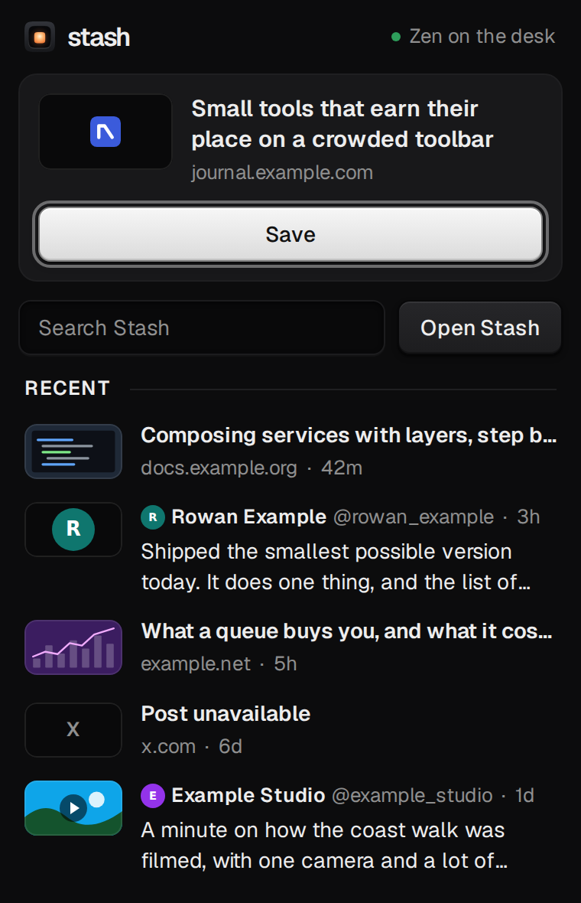 | 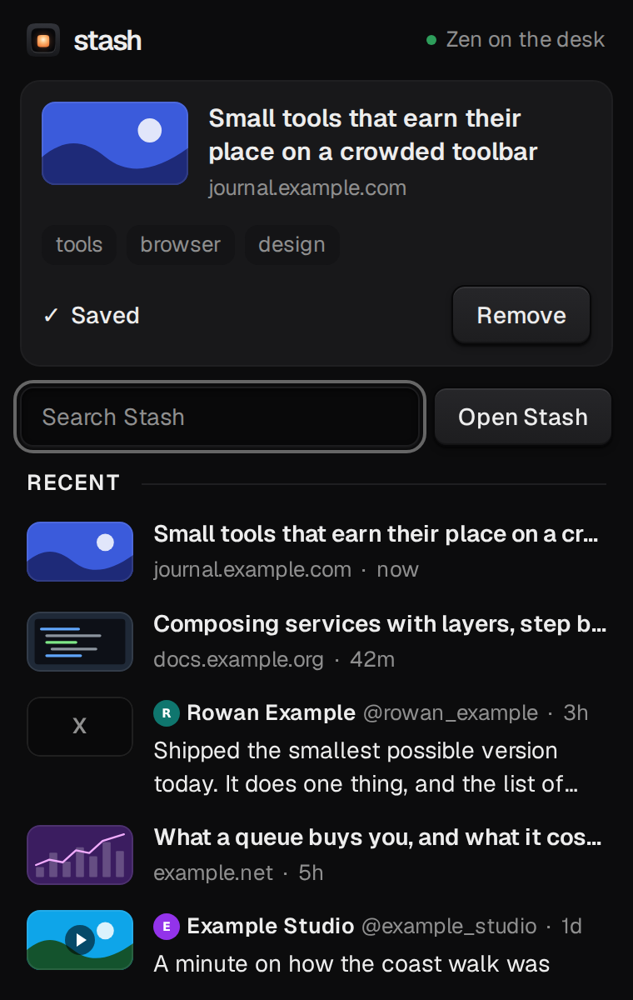 |

- **This page** with **Save**. The button has the focus, so <kbd>Enter</kbd> saves. Once the page
  is saved the focus is in the search field, so no key press deletes anything by accident. Right
  after a save the popup shows **Saved** and **Undo**, which deletes the link it just created. A
  page that was in Stash already (`GET /links?url=…`) shows **Saved** and **Remove**, which asks
  first (**Keep** / **Remove**). After
  a save the popup asks for the link every 2 seconds, for up to 40, and shows its tags and preview
  when enrichment is done.
- **Search Stash**: type and press <kbd>Enter</kbd> to open `<stash>/search?q=…`. **Open Stash**
  switches to a Stash tab if one is open, and opens one otherwise.
- **Recent**: the last 5 saved links. A click opens the link.
- The corner shows the device this browser is connected as, or **Connect this browser** until it
  is paired.

The popup follows the browser's light or dark theme. `pnpm --filter @stash/extension screenshots`
retakes the pictures from made-up data (`preview/popup/`).

Press <kbd>Alt</kbd>+<kbd>Shift</kbd>+<kbd>S</kbd> to save the current tab without opening the
popup (change the shortcuts at `about:addons` → ⚙ → "Manage Extension Shortcuts"). The badge on the
toolbar button shows the result for a few seconds: `✓` saved, `wait` rate limited, `off` API unreachable, `!` not
saved (hover for the reason). Rate-limited and offline saves, and saves made before the device
token is set, are queued in extension storage and sent again later.

Press <kbd>Alt</kbd>+<kbd>Shift</kbd>+<kbd>W</kbd> to save every tab of the window (in Zen, the
visible tabs, which are the current workspace) and close them. A small popup lists what will be
saved and asks first. Pinned tabs and pages that are not http(s) are skipped and stay open. The
tabs are sent with `POST /links/batch`, and only the tabs whose links come back saved are closed;
the rest stay open, so pressing the hotkey again retries them. If nothing would be left, a blank
tab is opened so the window stays.
